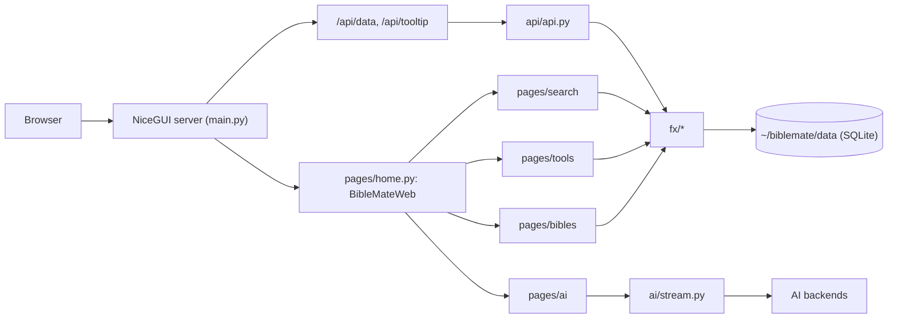

# Architecture

BibleMate AI Web is a Python application on **NiceGUI** (3.x) with an HTTP/UI server and a REST API in one process.

## Key ideas

- **Two areas.** `BibleMateWeb` (`pages/home.py`) owns the Bible Area (area 1) and Tool Area (area 2), each with tabs; content functions take `gui, b, c, v, area, tab1, tab2, ...` and render into a tab's scroll area.
- **Content registry.** `self.tools` in `BibleMateWeb.__init__` maps keywords (`xrefs`, `lexicons` ...) to page functions. `get_content()` also resolves Bible codes. Quick search, URL `tool=` and menus all use this.
- **State.** Per-user settings and tab state in `app.storage.user`; per-visit state in `app.storage.client` (e.g. `custom` flag from the token).
- **Default settings.** `USER_DEFAULT_SETTINGS` in `__init__.py`, applied at page load.
- **Config.** `~/biblemate/biblemateweb.config` loaded in `__init__.py`.
- **API.** `/api/data` parses `keyword:::options:::query` in `api/api.py`; the same engine feeds AI tools and quick search.
- **Events from HTML.** Bible HTML uses `emitEvent('name', [args])` calls translated to NiceGUI `ui.on` handlers (`lex`, `cr`, `bcv`, `luV1`, `luV2`, `note`, `wd`).
- **Streaming AI.** `pages/ai/stream.py` streams from agentmake backends or signed-in subscription CLIs.

See [Project Structure](project_structure.md).
