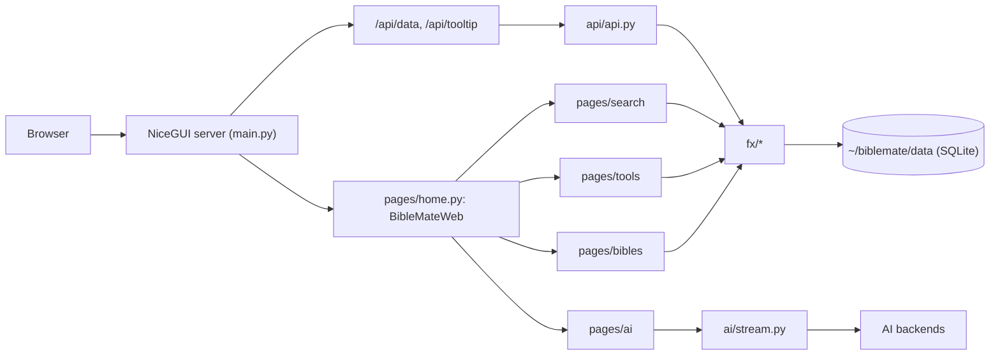

# 架构

BibleMate AI Web 是一个基于 **NiceGUI** (3.x) 的 Python 应用程序，在单一进程中集成了 HTTP/UI 服务器与 REST API。

## 核心概念

- **两个区域。** `BibleMateWeb` (`pages/home.py`) 拥有圣经区域（区域 1）与工具区域（区域 2），各自包含标签页；内容函数接收 `gui, b, c, v, area, tab1, tab2, ...` 并渲染至标签页的滚动区域中。
- **内容注册表。** `BibleMateWeb.__init__` 中的 `self.tools` 将关键字（`xrefs`、`lexicons` 等）映射至页面函数。`get_content()` 也负责解析圣经代码。快速搜索、URL `tool=` 与菜单均使用此机制。
- **状态。** 每个用户的偏好设定与标签页状态保存在 `app.storage.user`；每次访问的状态保存在 `app.storage.client`（例如来自令牌的 `custom` 标志）。
- **默认设定。** `__init__.py` 中的 `USER_DEFAULT_SETTINGS`，在页面加载时应用。
- **配置文件。** 在 `__init__.py` 中加载 `~/biblemate/biblemateweb.config`。
- **API。** `/api/data` 在 `api/api.py` 中解析 `keyword:::options:::query`；同一个引擎同时支持 AI 工具与快速搜索。
- **来自 HTML 的事件。** 圣经 HTML 使用 `emitEvent('name', [args])` 调用，转换为 NiceGUI 的 `ui.on` 处理程序（`lex`、`cr`、`bcv`、`luV1`、`luV2`、`note`、`wd`）。
- **流式 AI。** `pages/ai/stream.py` 从 agentmake 后端或已登录的订阅 CLI 进行流式传输。

请参阅 [项目结构](project_structure.md)。
