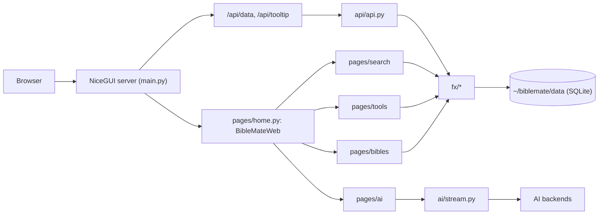

# 架構

BibleMate AI Web 是一個基於 **NiceGUI** (3.x) 的 Python 應用程式，在單一處理程序中整合了 HTTP/UI 伺服器與 REST API。

## 核心概念

- **兩個區域。** `BibleMateWeb` (`pages/home.py`) 擁有聖經區域（區域 1）與工具區域（區域 2），各自包含標籤頁；內容函式接收 `gui, b, c, v, area, tab1, tab2, ...` 並算繪至標籤頁的滾動區域中。
- **內容註冊表。** `BibleMateWeb.__init__` 中的 `self.tools` 將關鍵字（`xrefs`、`lexicons` 等）對應至頁面函式。`get_content()` 也負責解析聖經代碼。快速搜索、網址 `tool=` 與選單皆使用此機制。
- **狀態。** 每個使用者的偏好設定與標籤頁狀態保存在 `app.storage.user`；每次造訪的狀態保存在 `app.storage.client`（例如來自權杖的 `custom` 旗標）。
- **預設設定。** `__init__.py` 中的 `USER_DEFAULT_SETTINGS`，在頁面載入時套用。
- **設定檔。** 於 `__init__.py` 中載入 `~/biblemate/biblemateweb.config`。
- **API。** `/api/data` 在 `api/api.py` 中解析 `keyword:::options:::query`；同一個引擎同時支援 AI 工具與快速搜索。
- **來自 HTML 的事件。** 聖經 HTML 使用 `emitEvent('name', [args])` 呼叫，轉換為 NiceGUI 的 `ui.on` 處理常式（`lex`、`cr`、`bcv`、`luV1`、`luV2`、`note`、`wd`）。
- **串流 AI。** `pages/ai/stream.py` 從 agentmake 後端或已登入的訂閱 CLI 進行串流傳輸。

請參閱 [專案結構](project_structure.md)。
